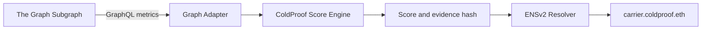

# ColdProof Score Engine

ColdProof converts aggregate carrier performance from The Graph into a
deterministic reputation snapshot stored on each `*.coldproof.eth` ENSv2
identity. This repository contains only that scoring pipeline.



## Score model

```text
score =
  complianceRate × 0.50
  + onTimeRate × 0.30
  + completionRate × 0.20
```

Rates and the final score are clamped to 0–100. Rates retain two decimals and
the score is rounded to a whole number. Zero shipments produces score `0`,
grade `N/A`, and status `insufficient_data`.

Grades: A+ (95–100), A (90–94), B (80–89), C (70–79), D (60–69), and Risk
(below 60).

## Setup

Requires Node.js 20 or newer.

```bash
npm ci
cp .env.example .env
```

Configure a Sepolia RPC URL and either a Graph endpoint or explicit fixture
mode. Fixture mode is never enabled automatically:

```env
GRAPH_FIXTURE_MODE=true
GRAPH_FIXTURE_FILE=./fixtures/carrier-metrics.json
SEPOLIA_RPC_URL=https://your-sepolia-rpc
```

Graph API keys may be embedded in `GRAPH_ENDPOINT`, supplied as a bearer token
through `GRAPH_API_KEY`, or sent through the custom `GRAPH_API_KEY_HEADER`.

## Commands

```bash
npm run scores:plan  # reads Graph/fixture and ENS; sends no transaction
npm run scores:sync  # requires confirmation and the ENS administrator key
npm test
npm run typecheck
```

Sync requires:

```env
SCORE_SYNC_CONFIRM=true
ENS_ADMIN_PRIVATE_KEY=
```

Before writing, the engine verifies Sepolia chain ID `11155111`, checks that
the private key matches `ENS_ADMIN_ADDRESS`, validates resolver permissions,
updates only changed records, and waits for each receipt.

## ENS records

The snapshot includes the score, grade, status, score version, timestamp,
shipment aggregates, incidents, component rates, Graph block, and deterministic
keccak256 evidence hash. It does not store individual deliveries, API keys,
private keys, full Graph responses, or personal data.

ENS reads and resolver discovery use the Universal Resolver. Writes go to the
resolver discovered through the active ENSv2 hierarchy; the project does not
use the legacy ENS registry or NameWrapper.

## Graph schema

`queries/carrier-metrics.graphql` is intentionally replaceable. The initial
query assumes a conceptual `carriers` entity. When the real subgraph schema is
available, update the query and, if field names or nesting differ, only
`src/graph/carrier-metrics-adapter.ts`. Scoring consumes the stable normalized
`CarrierMetrics` model.

The real subgraph must confirm:

- endpoint and authentication method;
- carrier entity and identifier;
- aggregate field names and scalar types;
- ENS identity field;
- pagination rules;
- `_meta.block.number` availability;
- timestamp format.

Every plan or sync execution writes a redacted audit report to `reports/`.
