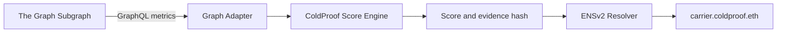

# ColdProof

ColdProof keeps one business workflow and selects its blockchain adapters at
runtime:

```env
BLOCKCHAIN_PROVIDER=hedera
```

or:

```env
BLOCKCHAIN_PROVIDER=sepolia
```

The application and domain layers are shared and unchanged. Both providers
implement the same three ports:

- `ConsensusLog`: append an authenticated sensor reading.
- `ConsensusReader`: read the immutable, ordered history used for settlement.
- `EscrowGateway`: check the escrow float and transfer a release or refund.

## Provider mapping

| Business capability | Hedera | Sepolia |
| --- | --- | --- |
| Immutable log | HCS topic | `ColdProofConsensus` events |
| History reader | Hedera Mirror Node | Sepolia RPC event query |
| Escrow float | Hedera operator account | Sepolia oracle wallet |
| Settlement asset | HBAR | Sepolia ETH |

This deliberately reproduces the existing Hedera behavior. The blockchain is
chosen only in configuration/composition; use cases do not branch on the
provider.

## Local verification

```sh
cd backend
npm ci
npm run typecheck
npm test

cd ../frontend
npm ci
npm run build

cd ../contracts
npm ci
npm test
```

Never commit `.env` files or private keys.

## Current Sepolia consensus deployment

- Contract: `0xD76568A73Ce725CEC073b7CDE1F86bd4723EA7c3`
- Start block: `11350115`
- Transaction:
  `0x8606ded77e469361c2dfb73290d9daa16af379b5d8019de382cbba937b2649b2`

Use the contract address and block as `SEPOLIA_CONSENSUS_ADDRESS` and
`SEPOLIA_CONSENSUS_START_BLOCK`.
## ColdProof Score Engine

The production score engine in `backend/` turns aggregate carrier performance
from The Graph into a deterministic 0–100 reputation snapshot on each
`*.coldproof.eth` ENSv2 identity. It never stores individual delivery records.



The formula in `backend/config/score-model.json` is:

`score = complianceRate × 0.50 + onTimeRate × 0.30 + completionRate × 0.20`

Rates are clamped to 0–100 and retained to two decimals. The score is clamped
and rounded to a whole number. Zero shipments yields score `0`, grade `N/A`,
and status `insufficient_data`. Grades are A+ (95–100), A (90–94), B (80–89),
C (70–79), D (60–69), and Risk (<60).

### Configuration and commands

From `backend/`, copy `.env.example` to an untracked `.env` and configure a
Sepolia RPC URL plus either a Graph endpoint or explicit fixture mode:

```text
GRAPH_FIXTURE_MODE=true
GRAPH_FIXTURE_FILE=./fixtures/carrier-metrics.json
```

Fixture mode is never automatic. Graph API keys may already be embedded in the
endpoint or supplied through `GRAPH_API_KEY`; `GRAPH_API_KEY_HEADER` selects a
custom header and defaults to `Authorization`. Partial GraphQL errors fail the
run unless `GRAPH_ALLOW_PARTIAL_ERRORS=true`.

```bash
npm run scores:plan  # reads Graph/fixture and ENS; never signs
npm run scores:sync  # requires SCORE_SYNC_CONFIRM=true and the admin key
npm run scores:test
npm run typecheck
```

Sync verifies chain ID `11155111`, verifies the private key's derived address,
preflights resolver permission, updates only changed records, and waits for the
Sepolia receipt. `SCORE_MIN_CHANGE` defaults to 1; supporting metric changes
still update even when the score delta is smaller. Plan and sync write a
redacted JSON audit report under `backend/reports/`.

The resolver snapshot contains:

- `com.coldproof.score`, `grade`, `scoreVersion`, `scoreStatus`,
  `scoreUpdatedAt`, and `dataHash`
- shipment totals for completed, compliant, on-time, and all shipments
- incidents and the three calculated rates
- the source Graph block when supplied

The evidence hash is keccak256 of canonical, key-sorted JSON containing only
the score version, carrier ID, and aggregate score inputs. No keys, complete
Graph responses, or personal data are stored on ENS or in reports.

### ENSv2 and subgraph assumptions

The engine uses the Universal Resolver as the hierarchy-aware read and resolver
discovery entrypoint, then writes to the discovered ENSv2 resolver using the
ENSv2 resolver node convention. It does not import the legacy ENS registry,
NameWrapper, or a hard-coded legacy public resolver.

`backend/queries/carrier-metrics.graphql` deliberately contains the conceptual
`carriers` schema from the initial brief. Once the real subgraph is published,
replace that query and update only `carrier-metrics-adapter.ts` if field names
or nesting differ. The scoring layer accepts only the normalized
`CarrierMetrics` model. The real schema must confirm the carrier entity and ID,
aggregate count scalar types, ENS field, pagination requirements, `_meta`
availability, and timestamp format.

Example plan output:

```text
PLANNED dhl-express.coldproof.eth: 94 -> 95 (A+)
Audit report: .../reports/score-sync-2026-07-25T20-00-00-000Z.json
```
